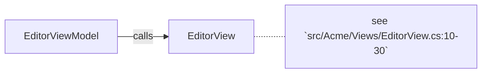

# EditorView

**public class** · in [Acme](../../../../module/src/Acme.md) · 58 lines · `src/Acme/Views/EditorView.cs:3-60` · card: [EditorView](../../../../type/csharp/Acme.Views/EditorView.md)

## Signature

```text
public class EditorView
```

## API

**Methods**

- `public void Check(bool flag)` · `src/Acme/Views/EditorView.cs:10-30`
  - uses [RelayCommand](../../../../type/csharp/Acme.Views/RelayCommand.md), [ViewA](../../../../type/csharp/Acme.Views/ViewA.md)
- `public void Save()` · `src/Acme/Views/EditorView.cs:32-40`
  - uses [ViewB](../../../../type/csharp/Acme.Views/ViewB.md)

**Properties**

- `public string Title` · `src/Acme/Views/EditorView.cs:6`

**Nested types**

- [Inner](../../../../type/csharp/Acme.Views/EditorView.Inner.md) `public class Inner` · `src/Acme/Views/EditorView.cs:42-58`

**Internals**

- `_dirty` — field · `src/Acme/Views/EditorView.cs:5`

## Referenced by

- calls `EditorViewModel.Run()` (heuristic, rules-backed) via `Check(bool)` — `src/Acme/Views/EditorViewModel.cs:12:35`

## Collaboration



## Test pairing

- test by convention not found — for the file `src/Acme/Views/EditorView.cs` (derived)
