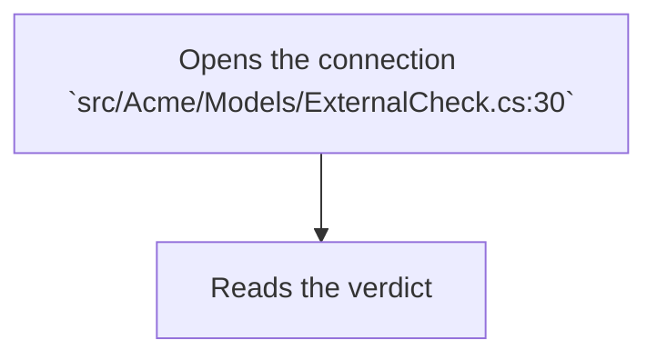
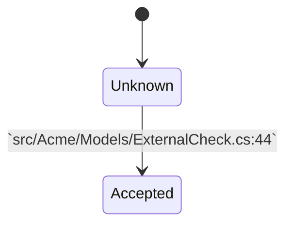

# ExternalCheck

**public class** · in [Acme](../../module/src/Acme.md) · 116 lines · `src/Acme/Models/ExternalCheck.cs:5-120`

- Identity: `sym:csharp:Acme.Models#ExternalCheck`

## Purpose

Checks a document against an external register. (from the structure)

## Functionality: Run

### Entry points

- called from `EditorViewModel.Save()` — `src/Acme/Models/ExternalCheck.cs:20`

### Preconditions

- the register address is set — `src/Acme/Models/ExternalCheck.cs:24`

### Dead paths

- the retry branch is never taken — `src/Acme/Models/ExternalCheck.cs:48`

### Steps

1. Opens the connection — `src/Acme/Models/ExternalCheck.cs:30`
2. Sends the document — `src/Acme/Models/ExternalCheck.cs:34-40`
3. Reads the verdict — `src/Acme/Models/ExternalCheck.cs:44`

This closing sentence has no anchor of its own.

### Flowchart

## Functionality: Validate

### Steps

1. Trims the input — `src/Acme/Models/ExternalCheck.cs:64`
   - uses [RelayCommand](RelayCommand.md)
2. Rejects an empty value — `src/Acme/Models/ExternalCheck.cs:70`

This sentence follows a step anchored in Validate and has no anchor of its own.

## State: _verdict

### Values

- `Unknown`, `Accepted`, `Rejected` — `src/Acme/Models/ExternalCheck.cs:8`

### Read in conditions

- `Run()` compares it before sending — `src/Acme/Models/ExternalCheck.cs:26`

### Changed by

- `Run()` — `src/Acme/Models/ExternalCheck.cs:44`

### State diagram

## Dynamic access

### Context

#### caller: EditorViewModel.Save

- reaches `Run()` through a command binding — `src/Acme/Models/ExternalCheck.cs:20`
